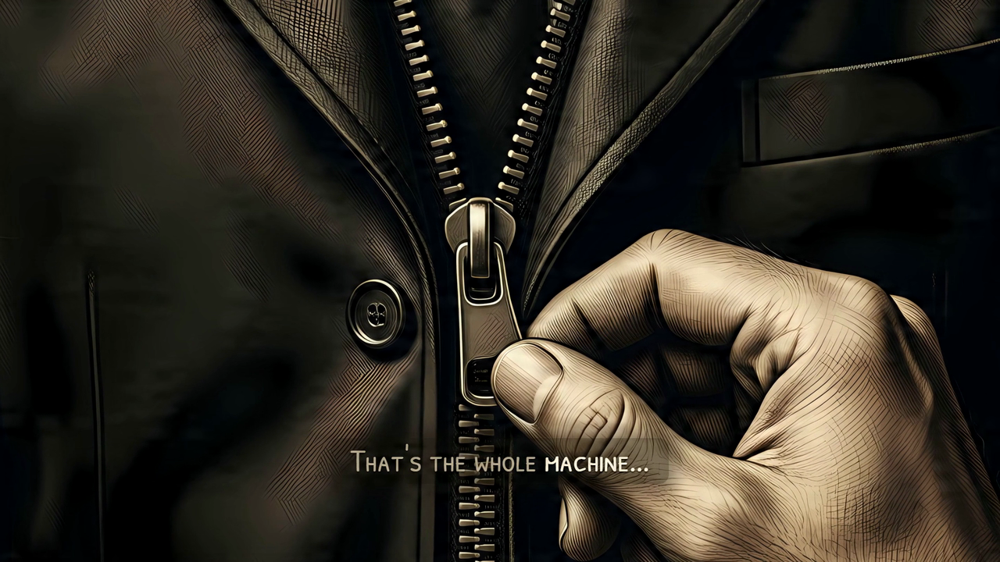

# Lanternist

**Faceless YouTube videos, made on your own PC with Claude Code.** Free and open source (MIT).

You bring a topic and your YouTube channel. Claude Code writes each script with you and turns it into a scene, and
Lanternist makes the video on your graphics card: the illustrations, the voice, the music and the 1080p render. What it
makes stays on your PC until you upload it ([what goes out](#what-goes-out-of-your-pc)).



*A frame of the example episode that ships with Lanternist: «How Does a Zip Work?», 54 seconds, in the «láminas»
format. The illustration, the camera move and the captions are the engine's. The frame carries Lanternist's AI marks.*

## What it does

- **Images**: Qwen-Image, running in [ComfyUI](https://github.com/Comfy-Org/ComfyUI) on your PC.
- **Voice**: [Kokoro](https://huggingface.co/hexgrad/Kokoro-82M) makes the voice of your channel, and
  [Orpheus](https://huggingface.co/canopylabs/orpheus-3b-0.1-ft) narrates every episode with it, on
  [llama.cpp](https://github.com/ggml-org/llama.cpp). You can also use a recording of your own voice.
- **Music**: [ACE-Step](https://huggingface.co/ACE-Step/ACE-Step-v1-3.5B).
- **The video**: a scene engine built on [HyperFrames](https://github.com/heygen-com/hyperframes),
  [GSAP](https://gsap.com) and WebGPU. Claude Code writes each episode's scene as a short Python file (`escena.py`), so
  every video is written as code ([how a scene is written](docs/scene-script.md)).
- **Provenance**: every run writes an `assets.json` with the source, the license and the URL of each piece it used.
- **Formats**: one is ready today, «láminas» (one illustration per idea, with the camera travelling over it). Two more
  are in preparation. They are all in the [catalogue of formats](docs/formats.md).

Claude Code is part of the engine. Its skills, in `.claude/skills/`, do the work with you:

| Skill | What it does |
|---|---|
| `instala-lanternist` | installs Lanternist and proves it works by making the example episode |
| `propone-formato` | looks at a YouTube link you paste and tells you which format is closest |
| `crea-canal` | sets up your channel: name, language, format, voice and look |
| `produce-semana` | makes your videos of the week, from the topics to the files ready to upload |
| `script-to-slides` | turns a script into the slides you approve before any GPU time is spent |
| `pone-en-escena` | writes and fixes the scene of an episode |

## You approve every step that matters

Lanternist proposes, and you decide. Three decisions are always yours, one by one:

1. **The format** of your channel, when you create it.
2. **Each script**, before any GPU time is spent on it.
3. **Each publication.** Lanternist never publishes. By default it uploads nothing: it leaves the video ready for you
   to upload by hand.

Inside each episode there are two more stops, after the images and before the render, so you can look at the frames
before the long work starts.

## What goes out of your PC

The images, the voice, the music and the video are made on your PC and stay there. Four things go out:

- **what you write with Claude Code**, which goes to Anthropic like any Claude Code session;
- **the source lookups** that check a script's facts: Wikipedia and Wikidata, Crossref, OpenAlex, GBIF, Open Library,
  archive.org and the pages that a script cites as its sources;
- **the title, channel and thumbnail of a YouTube link you paste**, which `propone-formato` reads from YouTube's
  public embed service (oEmbed);
- **the upload to YouTube**, only if you switch it on.

Installing downloads the models and tools from their original sources.

## Requirements

These are minimums, measured on the only PC where Lanternist has been tested. **Lanternist does not check your
hardware for you**: the installer checks the NVIDIA driver and the programs it needs, but not your VRAM, your RAM or
your free disk. Lanternist has not been tested below these figures: expect it to fail, possibly after a long
download.

| | Minimum |
|---|---|
| System | **Windows 11, 64-bit.** A Mac does not work: everything needs CUDA. Linux has not been tested |
| Graphics card | **An NVIDIA card with CUDA and 8 GB of VRAM or more**, with an up-to-date driver. Tested on an RTX 3060 Ti with 8 GB |
| Memory | **32 GB of RAM** |
| Disk | **About 95 GB free on an SSD**: 77 GB of models, and the rest for the Python environments. Then room for your videos: a 19-minute episode leaves a `final.mp4` of about 3 GB |
| Programs | Python 3.12 (`winget install -e --id Python.Python.3.12`), Git, Node.js and ffmpeg. If Git, Node.js or ffmpeg is missing, the installer tells you the `winget` command that installs it |
| Claude Code | **A high-usage Claude plan.** One episode, with its review, took 385 Claude replies. An entry plan will not produce a week of videos |

How long the graphics card works: the 54-second example episode takes about 11 minutes; a 19-minute episode in the
«láminas» format took about 2 hours 20 minutes.

## Install

1. **Clone this repository into a short folder**, such as `C:\lanternist`. Windows cannot load a DLL whose path is
   longer than 260 characters, and ComfyUI has very long paths inside.
2. **Open Claude Code in that folder and ask it to install Lanternist.** The `instala-lanternist` skill checks the
   requirements with you, runs the installer one step at a time and tells you what each step downloads before it
   starts. It ends by making the example episode from start to finish: if that video comes out marked, Lanternist
   works on your PC. It never asks for keys in the chat.

You can also run the installer yourself:

```powershell
py -3.12 instala.py --comprueba   # what is missing; downloads nothing
py -3.12 instala.py               # installs what is missing, in order
```

Running it again is safe: every step checks first whether it is done, and an interrupted download resumes. The models
and tools on the installer's fixed list (`datos/descargas.json`) are checked against their SHA-256 when they arrive, and
a file that does not match is deleted. Python and npm packages come at fixed versions, from PyPI and npm.

**If you already have ComfyUI or llama.cpp**, tell Claude before installing, or read
[the FAQ](docs/faq.md#i-already-have-comfyui-can-lanternist-use-it): the order of the steps matters.

## Uploading to YouTube

**By default Lanternist uploads nothing.** Each run ends with a folder, `subir-al-canal/`, that holds the video, the
thumbnail, the subtitles and a page, `LEEME.html`, with the title, the full description (chapters, sources and the AI
disclosure) and the steps to upload it by hand in YouTube Studio.

If you want Lanternist to upload for you, set `YOUTUBE_SUBIDA_API=1` and create **your own** Google Cloud project,
following [docs/youtube-upload.md](docs/youtube-upload.md). Lanternist ships no Google credentials. What the API upload
promises:

- the video arrives as a **private draft**, with YouTube's synthetic-content flag set and the AI disclosure in the
  description. Lanternist never publishes it: you do, in Studio;
- it was tested with a new Google project that Google has not audited, and its uploads behaved as normal drafts.
  Google's own documentation is not settled on what happens to uploads from such projects. If YouTube locks your draft
  as private, upload `final.mp4` by hand: everything you need is in `subir-al-canal/`;
- the Google setup guide has not yet been followed from scratch by a new user.

## AI marking

Every video and thumbnail that Lanternist makes carries **two machine-readable marks** that say it was made with AI:
signed metadata (C2PA) and an invisible watermark in the picture and in the sound. A second watermark in the picture,
a TrustMark signpost, tells other detectors which detector to use. They are always on, and the upload refuses a file
without them. The EU AI Act asks for this (Article 50(2)), also from open-source tools.

- **To check a file**, double-click `detector.cmd` and drag the file onto the page that opens. It runs on your PC and
  uploads nothing. From a terminal: `.venv\Scripts\python scripts\detecta_marca.py <file>`.
- **Expect YouTube's AI label on your videos.** An API upload tells YouTube that the video contains synthetic media.
  By hand, `LEEME.html` tells you to answer **yes** to Studio's question about altered or synthetic content. YouTube
  can also show its label when it reads C2PA metadata.

What is marked, how the detector decides and what survives re-encoding: [docs/ai-marking.md](docs/ai-marking.md).

## Acceptable use

By using Lanternist you agree to these rules. The MIT license lets you change the code; these rules are about what
you make with it.

- **Clone only your own voice.** Your channel's voice comes from Kokoro's catalogue or from a recording of yourself.
  A cloned voice of someone else is a deep fake.
- **Do not remove or tamper with the AI marks**, and do not publish Lanternist's videos without them. The exceptions
  are legitimate ones, such as security audits and research.
- **Do not present the videos as made by a person.** The Llama 3.2 Acceptable Use Policy, which applies to the voice
  model, forbids it.
- **Do not download videos from YouTube to imitate them.** YouTube's terms forbid it. `propone-formato` reads only what
  YouTube publishes for embedding a video (its title, channel and thumbnail), and the screenshots or video files you
  give it yourself.

## Licenses

- **Lanternist** is MIT-licensed: see [LICENSE](LICENSE). Its production skeleton comes from
  [faceless-youtube-agents](https://github.com/yashaiguy-dev/faceless-youtube-agents), also MIT.
- **Built with Llama.** The voice model, Orpheus TTS 3B, is a derivative of Llama 3.2. Llama 3.2 is licensed under the
  Llama 3.2 Community License, Copyright © Meta Platforms, Inc. All Rights Reserved. Using the voice means accepting
  that license and the
  [Llama 3.2 Acceptable Use Policy](https://github.com/meta-llama/llama-models/blob/main/models/llama3_2/USE_POLICY.md).
- **GSAP** is installed from npm under the GSAP Standard "No Charge" License
  ([gsap.com/standard-license](https://gsap.com/standard-license)). It is not an open source license, so GSAP is not
  part of Lanternist's MIT code and never travels in this repository. It allows free use «in commercial or
  non-commercial apps, web sites, games, components, and other software as long as end users are not charged a fee of
  any kind to use your product», and it forbids tools «that allow users to build visual animations without code» that
  compete with Webflow's. Lanternist is free, and its videos are written as code. If you build a paid product on top
  of Lanternist, read that license first.
- **Everything else** (ComfyUI, the models, the fonts, the tools the installer downloads) is listed with its license
  in [THIRD_PARTY_NOTICES.md](THIRD_PARTY_NOTICES.md). Nothing that cannot be redistributed travels in this
  repository: the installer downloads it from its original source.

## Language

This documentation is in English. The console messages, the skills and the manual that Claude Code reads
(`CLAUDE.md`) are in Spanish for now, and so is `LEEME.html`.

## Help and contributing

- **Installing** and how-to questions: GitHub Discussions, category *Installation*, and the [FAQ](docs/faq.md).
- **Bugs**: open an issue with the bug form. It asks for your Lanternist commit, your graphics card and the error.
- **A new format**: open an issue with the format form, or paste a video link to Claude and let `propone-formato` say
  what the engine would need.
- **Code**: read [CONTRIBUTING.md](CONTRIBUTING.md).
