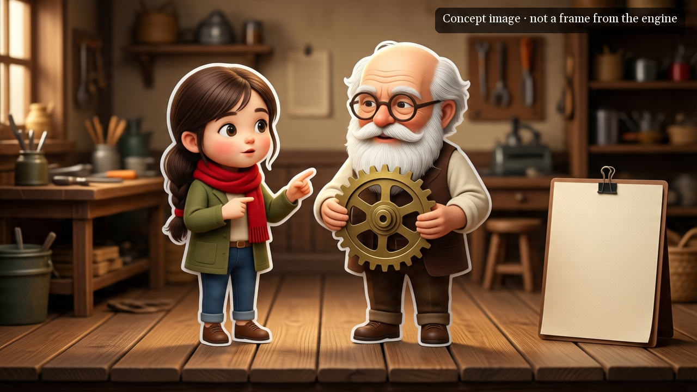

# Video formats

A **format** is how the videos of a channel look on screen and how they move: what is shown, what is animated and
what the camera does. Lanternist's scene engine produces every video of a channel in one format from this catalog.
This page is the catalog: what each format looks like, which channels it suits, what you set in your channel profile
and whether you can produce in it today.

| Format | In short | Status |
|---|---|---|
| [`laminas`](#laminas--illustrated-slides-with-a-moving-camera) | one illustration per idea, with the camera travelling over it | **Ready** |
| [`personajes`](#personajes--cut-out-characters-in-a-scene) | drawn characters who walk, talk and handle objects in a set | **In preparation** |
| [`pizarra`](#pizarra--a-chalkboard-that-fills-up) | a chalkboard that fills up with drawings, text and charts as the voice speaks | **In preparation** |

**In preparation** means that the engine has done this format before, but Lanternist does not ship what a new channel
needs to start in it. It is not produced until someone asks for it (see [Adding a format](#adding-a-format)).

The format names are the Spanish words that the profile and the command line use: *láminas* (plates), *personajes*
(characters) and *pizarra* (chalkboard).

## How a channel chooses its format

The format is written in the channel profile, `canales/<channel>/perfil.json`, and the `escena` block decides it
(`lib/escena/ajustes.py → formato`):

| The `escena` block has | Format |
|---|---|
| a `laminas` block | `laminas` |
| a `pizarra` block | `pizarra` |
| neither | `personajes` |
| both | refused: a channel produces in one format |

You choose it when you create the channel, with `canal.py --nuevo <channel> ... --formato laminas`.

Every format shares the rest of the `escena` block: the frame rate and size (`fps`, `marco`), the camera shake
(`camara_en_mano`), the movement of figures and elements (`movimiento`), the pauses (`pausas`), how the narration is
cut into cues and karaoke groups (`cues`, `karaoke`, `habla`), who speaks (`reparto`, `narrador`) and where the karaoke
sits on screen (`franja_karaoke_y`). None of these has a default: if the profile does not declare one, the run stops
and says what to write. The full list, with what each value means, is in `lib/escena/ajustes.py → CAMPOS`, and
`canales/example/perfil.json → escena` is a complete example.

A format decides **how the video moves**. **How it looks** (the style of the images, the colours, the fonts) is your
channel's identity: `perfil.json → formato.estilo_visual`, the image model and prompt contract in `imagen` and
`formato.contrato_de_prompt`, and the channel's scene layer in `canales/<channel>/escena/` (its CSS, and its titles or
characters when the format uses them). How to write an episode's scene script is in [scene-script.md](scene-script.md).

## The formats

### `laminas` — Illustrated slides with a moving camera


*A frame of the example channel's episode "How Does a Zip Work?", made with Lanternist. Like everything Lanternist
outputs, the image carries its AI marks ([AI marking](ai-marking.md)).*

- **What you see**: one full-screen illustration for each stretch of narration. The camera travels over the whole
  illustration without ever showing its edge: it pushes in, pans, descends and pulls back. Each illustration is split
  into shots of about 10 seconds, each with its own movement, and the shots are joined by ink transitions: a dissolve,
  an ink bleed, ink wipes and streaks, an ink blot and a paper flash. On top runs a one-line karaoke of the
  narration. A channel can add, in its scene layer, its name and the episode title written in ink and a subscribe
  banner with a bell over the last illustration. Nothing inside the illustration moves on its own.
- **Good for**: narrated channels where one strong image per idea carries the story: history, how things work,
  inventions, explainers, short documentaries. It is the lightest format to produce: a one-minute episode needs
  three images.
- **What you set** in `perfil.json → escena.laminas` (no defaults; the meaning of each key is in
  `lib/escena/laminas.py → AJUSTES`):

  | Key | What it is | Example channel |
  |---|---|---|
  | `zoom_base` | the minimum zoom, above 1, so the edge of the illustration stays out of frame | `1.06` |
  | `zoom_maximo` | the maximum zoom | `1.45` |
  | `toma_s` | how long a shot lasts, in seconds | `10` |
  | `toma_minima_s` | the shortest a shot can be | `5` |
  | `transicion_s` | how long a transition lasts, in seconds | `2.0` |
  | `transiciones_excluidas` | the transitions the channel does not want, `[]` for none; at least one soft and one ink transition must remain | `["plate_reveal"]` |
  | `fuentes_de_los_rotulos` | the fonts of the ink titles, from `datos/escena/fuentes/` (each with its licence) | Gelasio |

  And `camara_en_mano: 0` in the shared block: a shaking camera would bring the edge of the illustration into frame.
- **Status**: **Ready**. You can produce in it today.
- **Channels**: `example` (Lantern Slides, the example channel that ships with Lanternist).

### `personajes` — Cut-out characters in a scene



*Concept image, not a frame from the engine.*

- **What you see**: drawn characters who walk, talk and change pose inside sets with a floor. The camera cuts between
  shots and moves a little, as if hand-held. The characters pick up and put down objects, and a teaching layer brings
  in cards, chips and labels. The narration runs as karaoke. The characters are rigid: they change pose by swapping
  cut-outs, which are generated from the character's reference image and cut out automatically.
- **Good for**: channels with recurring characters: stories, dialogues, sketches, or explainers with a host character.
- **What you set**: it has no block of its own. A profile whose `escena` block has neither `laminas` nor `pizarra` is
  in this format, and it uses the whole shared block: `movimiento` (how characters walk, talk and breathe, and their
  gestures), `fundido` (the fade between two poses), `camara_en_mano` (`1` is the calibrated shake) and `reparto` (the
  name of each character in the script, mapped to its id). Most of the format lives in the channel's scene layer,
  `canales/<channel>/escena/`: the characters, the sets, the teaching helpers and their layout, the opening and the
  closing.
- **Status**: **In preparation**. To produce in it, a channel needs a starting scene layer (characters, sets and
  helpers it can adapt), and Lanternist does not ship one yet. It will be built when a user needs it.
- **Channels**: none yet.

### `pizarra` — A chalkboard that fills up


*Concept image, not a frame from the engine.*

- **What you see**: an edge-to-edge chalkboard that fills up, part by part, in time with the voice. Every few seconds
  a drawing, a label or a number appears, at once or with a short fade, with no hand. Text is written stroke by
  stroke, bar charts are drawn from their data and arrows have flowing dashes. The camera is almost still, and slowly
  moves closer on a crowded board. Between two boards there is a straight cut, or a short fade when the topic changes.
  The episode title is written in the middle of the empty board and then wiped off. There is no karaoke: the board is
  already full of text.
- **Good for**: explainers built on numbers and diagrams: economics, science, business, lessons.
- **What you set** in `perfil.json → escena.pizarra` (no defaults; the full list, with what each value means, is in
  `lib/escena/pizarra.py → AJUSTES`):

  | Group | What it controls |
  |---|---|
  | `separa` | how the chalk is told apart from the board and split into pieces that appear one by one |
  | `pieza` | the short fade of a piece that does not appear at once |
  | `camara` | the still camera's zoom, and how far and how fast it moves closer on a crowded board |
  | `transicion` | the fade between two boards on different topics |
  | `texto` | the chalk font (from `datos/escena/fuentes/`), the timing of each letter's stroke and fill, spacing, sizes and the eraser |
  | `flecha` | the speed of the flowing dashes and the size of the arrowhead |
  | `grafica` | the bar charts: the gap between bars, the drawing time and the chalk hatching |

  The channel's scene layer adds the chalk and board colours, the chalk texture, the font and where the titles go. Its
  prompt contract asks the image model for drawings without letters or numbers, because all the text is written by
  code, and the numbers come from the episode's sources or from a calculation, never from the image model.
- **Status**: **In preparation**. Like `personajes`, it needs a starting scene layer that Lanternist does not ship
  yet. It will be built when a user needs it.
- **Channels**: none yet.

## Adding a format

Paste the link to a video whose look you want, and ask Claude Code for a format: the `propone-formato` skill looks at
the video, compares it with this catalog and proposes the closest format, with its profile settings.

- **Lanternist does not download the video.** YouTube's Terms of Service forbid downloading content and accessing the
  service by automated means. From the link, Lanternist only reads what YouTube offers for embedding (oEmbed): the
  title, the channel and the thumbnail.
- **If the thumbnail is not enough**, Claude asks you for three or four screenshots, or for a video file of your own,
  and the frames are taken from it on your PC with ffmpeg.
- The skill runs this command, which you can also run yourself:

  ```
  .venv\Scripts\python scripts\mira_video.py <link> [--capturas shot1.png shot2.png] [--video my-video.mp4]
  ```

  It leaves a contact sheet, the thumbnail, the video's data and a page in `experimentos/formatos/<video id>/`
  (in a folder named `local` when there is no link).
  A link that is not a video (a playlist, a channel, another website) or that cannot be read (a private or deleted
  video) is refused with the reason.

**If no format fits, it is a new format, and a new format is programming**: a new kind of scene in the engine, not a
setting in the profile. The skill tells you what it would take, without promising a date. Whatever a new format needs
(sound effects, fonts or reference images) comes from a source with a free licence and is recorded with its
provenance, like every asset Lanternist uses.
